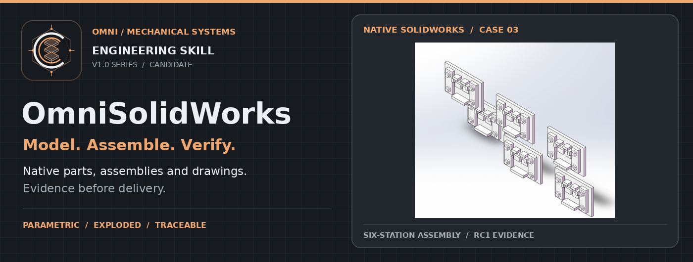
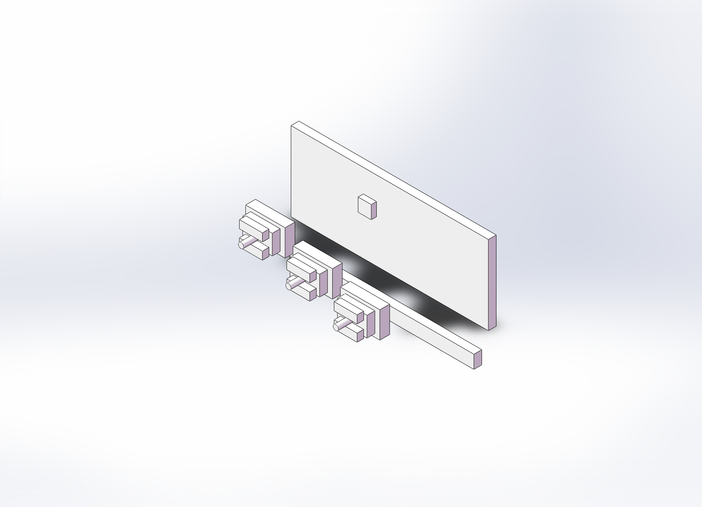
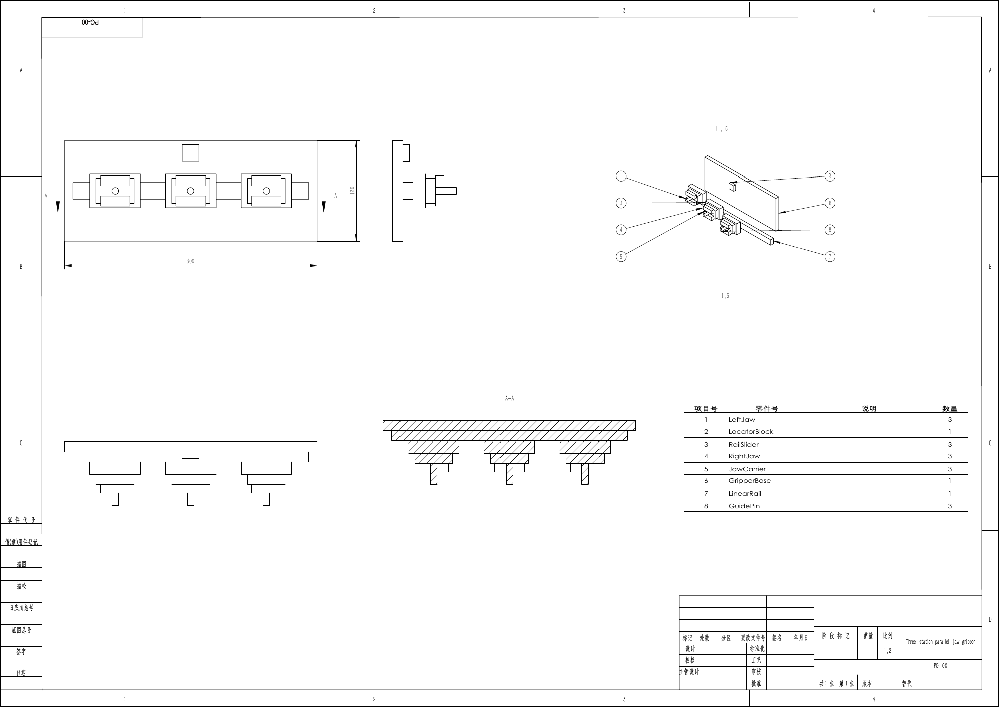
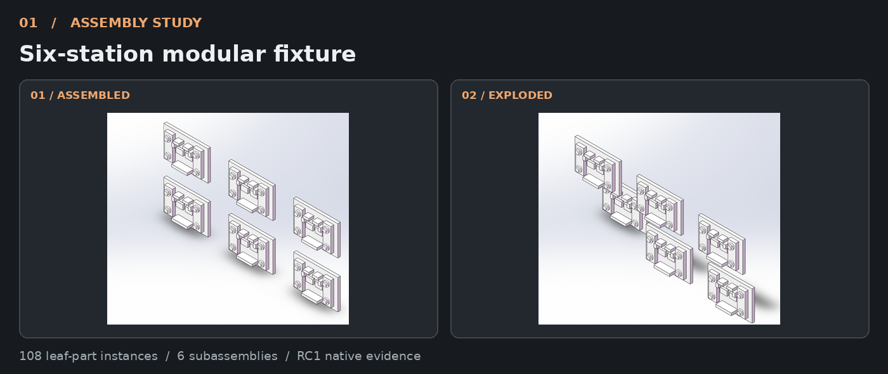
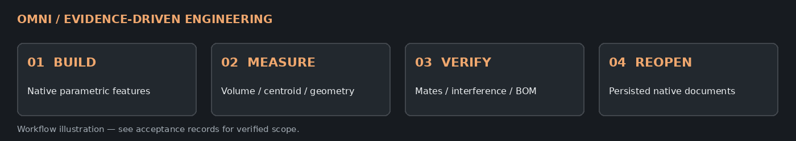
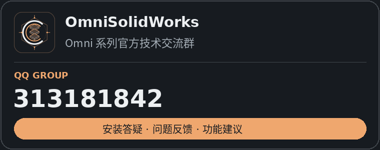

<p align="center"></p>

<p align="center"><a href="https://github.com/Haruhi764/OmniSolidWorks-Skill/releases/tag/v1.0.0"><strong>Download V1.0.0</strong></a> · <a href="#installation-and-use">Quick start</a> · <a href="README.md">中文</a> · <a href="SKILL.md">Agent Skill</a> · <a href="FINAL_ASSESSMENT.md">Validation</a></p>

# OmniSolidWorks Skill

**Native mechanical models. Editable assemblies. Verifiable engineering deliverables.**

A SolidWorks automation skill for Codex, using local COM/API to create parametric parts, hierarchical assemblies, exploded views and drawings with geometry, mates, BOM and reopen checks.

> V1.0.0 uses RC3 as its technical baseline. Verified host: SolidWorks 2014 x64 SP0 (COM 22.0.0). Native route-line persistence remains experimental.

## Core capabilities

| Parametric modeling | Mechanical assembly | Engineering deliverables |
| --- | --- | --- |
| Native features, dimension edits and rebuilds | Nested assemblies, mates and explode steps | Drawings, sections, BOM, balloons and disassembly tables |

The portfolio below shows actual SolidWorks outputs, not concept renders.

## Mechanical portfolio

### Three-station parallel-jaw gripper

The independent acceptance case generated eight parametric part types, three distinct subassemblies and 18 part occurrences. The top assembly has five native explode steps. The first-angle A2 drawing includes a section, linked dimensions, an eight-row BOM and balloons. The folded assembly passed the native static solid interference check.

| Native exploded view | Native A2 drawing |
| :---: | :---: |
| [](case-review/GripperExploded.png) | [](case-review/GripperDrawing.png) |
| [Disassembly steps](case-review/DisassemblySteps.csv) | [RC3 case acceptance](V1_SCOPE.md) |

### Six-station assembly and archived work



[Folded](case-review/MultiStationCollapsed.png) · [Exploded](case-review/MultiStationExploded.png) · [Guide fixture A3 drawing](case-review/GuideFixtureDrawing.png) · [Guide fixture BOM](case-review/BOM.csv) · [Bearing block A2 section](case-review/BearingBlockA2.png)

The banner and the six-station images show earlier native CAD evidence. The three-station gripper is the later independent acceptance case. Native document sets and raw COM logs remain in local validation storage.

## Evidence-driven engineering



| Stage | Native and automated evidence |
| --- | --- |
| **MODEL** | Parametric features, volume, centroid and geometry dimensions. |
| **ASSEMBLE** | Nested structure, component references, mates, transforms and folded static solid interference. |
| **VERIFY** | Parameter edits and rebuilds, negative testing and native SolidWorks readback. |
| **DELIVER** | Save, close and reopen, drawings, linked dimensions, BOM and balloons, checkpoints and SHA-256 file hashes. |

| Status | Verification scope |
| --- | --- |
| **PASS** | Accepted native part, assembly, explode-step and drawing workflows on SolidWorks 2014 x64 SP0. |
| **EXPERIMENTAL** | G06 native route-line persistence failed reopen. Disassembly documentation uses native steps, balloons and a step table. |
| **NOT VERIFIED** | Other major releases and cross-machine compatibility. |
| **NOT SUPPORTED** | Continuous swept-solid collision detection and automated motion simulation. Continuous-motion checking uses a swept AABB broad phase. |

RC2 scored 90/100. RC3's 24 unit tests, 113-file manifest verification and independent installation are inherited evidence. Some gripper mates retain in-plane freedom. SolidWorks 2014 has a known `sldapiu.dll` access violation. [Acceptance](FINAL_ASSESSMENT.md) · [Compatibility](ENVIRONMENT_COMPATIBILITY.md) · [Known limits](OPEN_ITEMS.md)

## OmniGB Core

Checks drawing dimension chains, repeated spans, sheet bounds and BOM-to-balloon consistency, with an index of public GB standards metadata. See [rule coverage](GB_RULE_COVERAGE.md) for tolerances, surface finish and other manufacturing annotations.

## Installation and use

Download and extract the official ZIP from [V1.0.0 Release](https://github.com/Haruhi764/OmniSolidWorks-Skill/releases/tag/v1.0.0).

Use Windows x64, Python 3.12+, Windows PowerShell 5.1 and a licensed SolidWorks installation. Open an empty SolidWorks session and run these commands from the extracted bundle. Choose a new local destination.

```powershell
python -B scripts/v03_jobs.py --preflight
powershell.exe -NoProfile -ExecutionPolicy RemoteSigned -File .\scripts\Install-SolidWorksSkill.ps1 -Destination 'D:\OmniSolidWorks' -Smoke
```

If Python is outside PATH, pass its full path with `-Python`. With multiple sessions, use `SOLIDWORKS_TARGET_PID` to select an empty one. To uninstall, back up any needed `outputs` and remove the standalone installation directory. [Skill](SKILL.md) · [Workflow](docs/V03_GUIDE.md) · [Explode guide](docs/EXPLODED_VIEW_GUIDE.md) · [Security](SECURITY_AUDIT.md) · [Release notes](RELEASE_NOTES.md)

## Official technical community

<p align="center"></p>

QQ **313181842**. Include the CAD version, reproduction steps and sanitized examples. The original project content the owner can license is covered by [MIT](LICENSE). See [third-party notices](THIRD_PARTY_LICENSES.md).

---
<p align="center"></p>
<p align="center"><strong>OMNI · Model / Assemble / Verify</strong></p>
<p align="center">Related project: <a href="https://github.com/Haruhi764/OmniCAD-Skill">OmniCAD</a></p>
