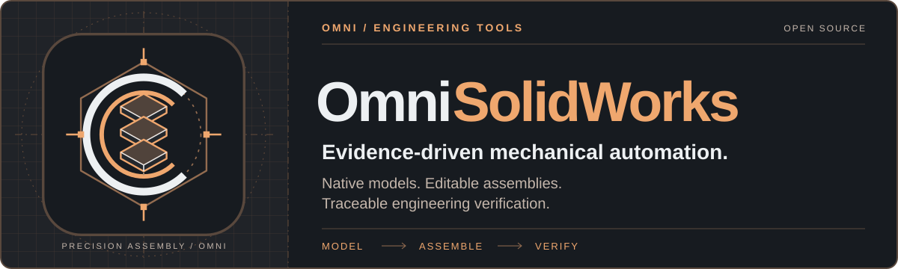
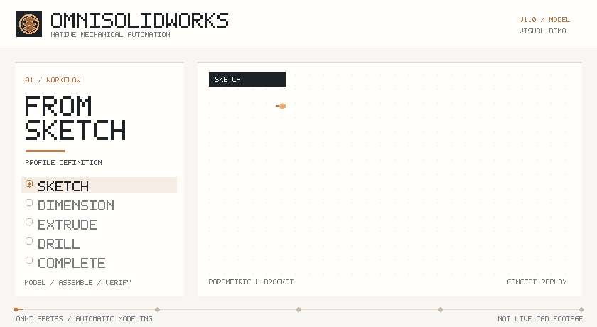
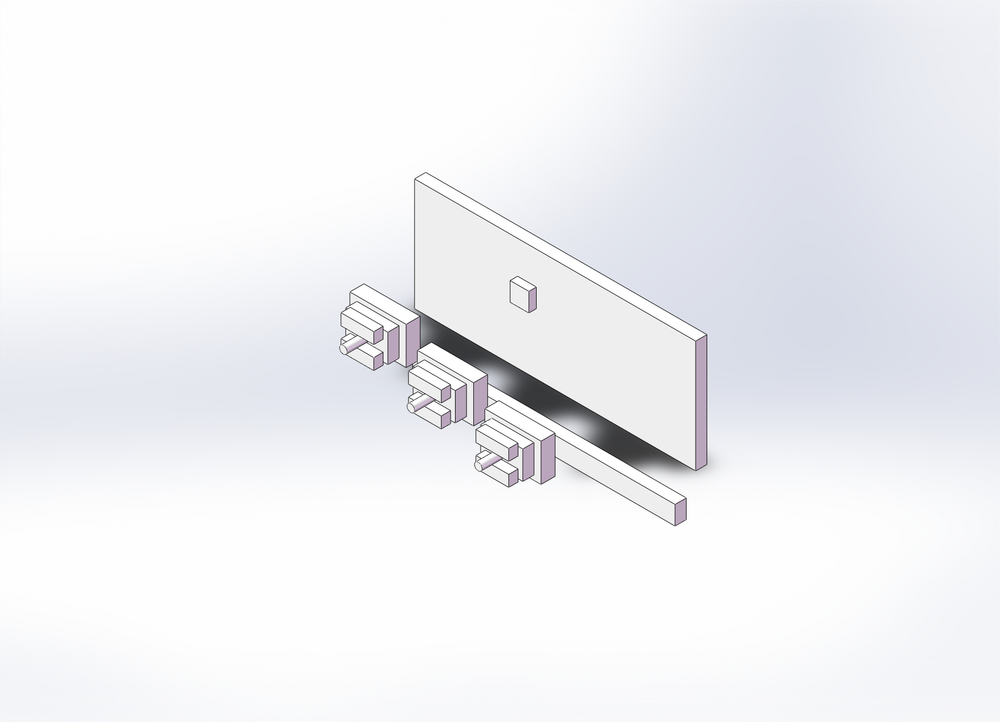
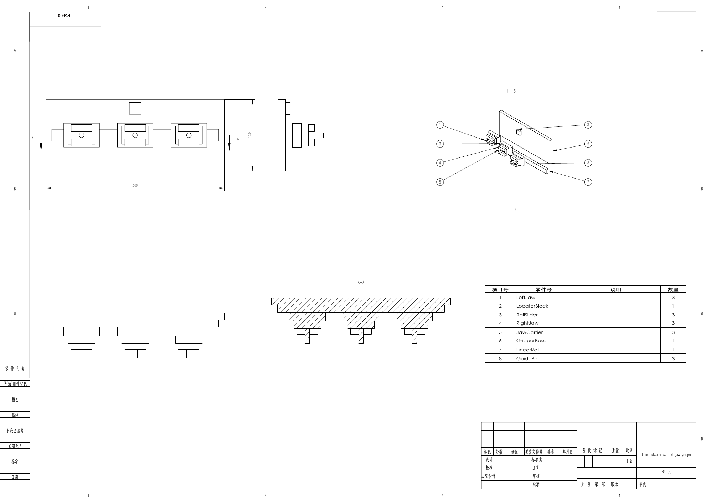
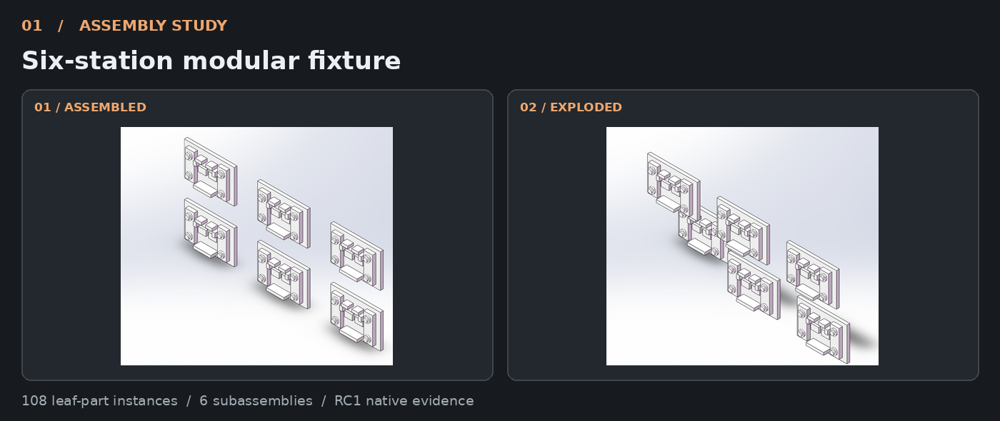
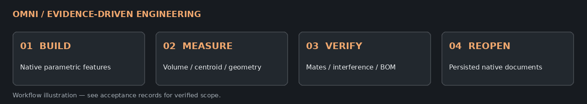

<p align="center"></p>

<p align="center">
  <a href="LICENSE"></a>
  <a href="SKILL.md"></a>
  <a href="ENVIRONMENT_COMPATIBILITY.md"></a>
  <a href="https://github.com/Haruhi764/OmniSolidWorks-Skill/stargazers"></a>
  <a href="https://github.com/Haruhi764/OmniSolidWorks-Skill/forks"></a>
</p>

<h1 align="center">OmniSolidWorks-Skill — AI 机械建模与 SolidWorks 自动化</h1>

<p align="center"><strong>不止于建模，更让每一次装配与交付有据可查。</strong></p>

<p align="center"><a href="README.en.md">English</a> · <a href="SKILL.md">Agent Skill</a> · <a href="ACCEPTANCE_REPORT.md">补丁验收</a> · <a href="ENVIRONMENT_COMPATIBILITY.md">兼容性</a> · <a href="RELEASE_NOTES.md">发布说明</a></p>

面向 Codex 的 SolidWorks 原生机械建模与装配 Skill，通过本地 COM/API 构建参数化零件、多级装配、爆炸视图和工程图，并以实际几何、配合、BOM 与重开结果作为验收依据。

> **V1.0.1-RC1 已进入预发布。** SolidWorks 2014 x64 SP0（COM 22.0.0）已完成实机测试。SolidWorks 2024 尚未完成实机验证。SolidWorks 2026 兼容性补丁已完成并通过模拟测试，等待外部实机复测。原生路线线持久化仍为实验性能力。

[下载 V1.0.0 稳定版](https://github.com/Haruhi764/OmniSolidWorks-Skill/releases/tag/v1.0.0) · [下载 V1.0.1-RC1 预发布](https://github.com/Haruhi764/OmniSolidWorks-Skill/releases/tag/v1.0.1-rc.1) · [快速安装](#安装与使用) · [工程案例](#工程案例--mechanical-portfolio) · [证据驱动](#证据驱动--evidence-driven)

## 自动建模演示

<p align="center"></p>

<p align="center"><sub>参数化建模流程概念动画，非 SolidWorks 实机录屏。真实输出与验证记录见下方工程案例。</sub></p>

## 核心能力 · Core Capabilities

| 01 / MODEL · 建模 | 02 / ASSEMBLE · 装配 | 03 / VERIFY · 验证 |
| --- | --- | --- |
| 原生特征、尺寸修改与重建 | 多级子装配、配合、爆炸步骤 | 几何回读、静态干涉、工程图与重开 |

**先看案例，再看验收。** 工程案例展示真实 SolidWorks 输出；创新设计展区另列合作作品。

## 工程案例 · Mechanical Portfolio

### 01 / 三工位平行夹爪

正式独立盲测从 8 种参数化零件生成 3 个子装配和 18 个零件实例。顶层 5 步原生爆炸。第一角投影 A2 工程图含剖视、关联尺寸、8 行 BOM 和气泡。折合状态的原生实体干涉为零。

| 原生爆炸视图 | A2 原生工程图 |
| :---: | :---: |
| [](case-review/GripperExploded.png) | [](case-review/GripperDrawing.png) |
| [拆装步骤表](case-review/DisassemblySteps.csv) | [RC3 案例验收](V1_SCOPE.md) |

### 02 / 六工位装配与历史案例



[六工位折合](case-review/MultiStationCollapsed.png) · [六工位爆炸](case-review/MultiStationExploded.png) · [导向夹具 A3 图纸](case-review/GuideFixtureDrawing.png) · [导向夹具 BOM](case-review/BOM.csv) · [轴承座剖视](case-review/BearingBlockA2.png)

六工位折合与爆炸图为早期实机案例。三工位夹爪是后续正式盲测案例，实机工程文件和原始 COM 日志保留在本地验收环境。

## 创新机械设计 · Innovative Mechanism

### 01 / 管道清扫机器人

<p align="center"><a href="OmniSolidWorks-robot-showcase%281%29.png"></a></p>

| 三向定心机构 | 叶轮式旋转机构 | 弹性过载缓冲连杆 |
| :---: | :---: | :---: |
| 定心与支撑 | 旋转结构设计 | 柔性连接与缓冲 |

<sub>社区合作作品，经原作者授权展示。展示图为视觉整理，不属于 OmniSolidWorks V1.0 独立生成或验收成果；原始设计文件未随项目开源，作品权利归原作者所有。</sub>

## 证据驱动 · Evidence-Driven



| 环节 | 原生与自动验收证据 |
| --- | --- |
| **MODEL** | 参数化特征、体积、质心和几何尺寸。 |
| **ASSEMBLE** | 多级结构、组件引用、配合、变换及折合状态静态实体干涉。 |
| **VERIFY** | 参数修改与重建、错误输入拒收和 SolidWorks 原生读回。 |
| **DELIVER** | 保存关闭重开、工程图、关联尺寸、BOM 与气泡、检查点和文件 SHA-256。 |

| 状态 | 实测边界 |
| --- | --- |
| **PASS** | SolidWorks 2014 x64 SP0 上的已验收零件、装配、原生爆炸步骤和工程图工作流。 |
| **EXPERIMENTAL** | G06 原生路线线重开持久化未通过。拆装资料采用原生步骤、气泡和步骤表。 |
| **SIMULATION PASS** | SolidWorks 2026 的 STEP 圆柱拆分和未知原生容器，待外部实机复测。 |
| **NOT VERIFIED** | SolidWorks 2024、其他主版本及跨机器实机兼容性。 |
| **NOT SUPPORTED** | 连续实体扫掠碰撞与自动运动仿真。连续运动仅做 AABB 粗筛。 |

RC2 全量验收 90/100，RC3 的 24 项单测、113 项清单校验和独立安装是历史证据。部分夹爪配合保留平面内自由度；2014 的 `sldapiu.dll` 访问违规是已知宿主风险。 [V1.0.0 历史验收](FINAL_ASSESSMENT.md) · [兼容性](ENVIRONMENT_COMPATIBILITY.md) · [已知限制](OPEN_ITEMS.md)

#### V1.0.0 · 实际验证记录

| **90/100** | **24** 项单测 | **SolidWorks 2014** |
| :---: | :---: | :---: |
| RC2 全量验收 | RC3 历史记录 | x64 SP0 原生实测 |

## OmniGB Core

对图纸尺寸链、重复跨度、纸面边界、BOM 和气泡一致性进行检查，并提供公开标准题录索引。公差、粗糙度及其他制造语义覆盖见[国标规则范围](GB_RULE_COVERAGE.md)。

## 安装与使用

从 [V1.0.0 稳定版](https://github.com/Haruhi764/OmniSolidWorks-Skill/releases/tag/v1.0.0) 或 [V1.0.1-RC1 预发布](https://github.com/Haruhi764/OmniSolidWorks-Skill/releases/tag/v1.0.1-rc.1) 下载对应的安装 ZIP，核对同页的 SHA-256 后解压。参与 SW2026 外测时，使用新的安装目录并保留旧安装。 [SW2026 复测指南](docs/ISSUE_2_SW2026_RETEST.md)

需要 Windows x64、Python 3.12+、Windows PowerShell 5.1 和已许可的 SolidWorks。打开空白 SolidWorks 会话，在解压目录运行。安装目标须为本地新目录。

```powershell
python -B scripts/v03_jobs.py --preflight
powershell.exe -NoProfile -ExecutionPolicy RemoteSigned -File .\scripts\Install-SolidWorksSkill.ps1 -Destination 'D:\OmniSolidWorks' -Smoke
```

Python 未加入 PATH 时，可将完整路径传给 `-Python`。多会话可用 `SOLIDWORKS_TARGET_PID` 选择空白会话。卸载前备份需保留的 `outputs`，再删除独立安装目录。 [Skill](SKILL.md) · [操作指南](docs/V03_GUIDE.md) · [爆炸图指南](docs/EXPLODED_VIEW_GUIDE.md) · [补丁安全审计](FINAL_SECURITY_AUDIT.md) · [发布说明](RELEASE_NOTES.md)

## 官方技术交流群

<p align="center"></p>

QQ **313181842**。建议附 CAD 版本、复现步骤和脱敏样例。项目有权授权的原创内容采用 [MIT](LICENSE)，第三方范围见[授权说明](THIRD_PARTY_LICENSES.md)。

---
<p align="center"></p>
<p align="center"><strong>OMNI · Model / Assemble / Verify</strong></p>
<p align="center"><a href="https://github.com/Haruhi764/OmniSolidWorks-Skill/issues">问题反馈</a> · <a href="https://github.com/Haruhi764/OmniSolidWorks-Skill/releases">版本下载</a></p>

## Omni 系列 · Two dimensions, one philosophy

| <a href="https://github.com/Haruhi764/OmniCAD-Skill"></a> |  |
| :---: | :---: |
| **[OmniCAD](https://github.com/Haruhi764/OmniCAD-Skill)** | **OmniSolidWorks** |
| 二维工程制图 · Draft / Verify / Deliver | 三维机械建模 · Model / Assemble / Verify |

